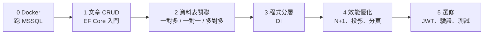

# BlogApi：從零做一個部落格 Web API

一邊做部落格 Web API，一邊學 .NET 後端的學習專案。
以部落格的功能當主線，每個階段遇到問題時，再學對應的主題：Docker、資料表關聯、LINQ / EF Core、DI、查詢效能優化。

📖 **學習筆記（HTML 版）**：https://jackson204.github.io/BlogApi/
> 筆記放在 [`docs/`](docs/)，透過 GitHub Pages 發布。每一課都有圖解和練習題，參考答案預設摺疊，寫完再打開對照。

## 技術

- .NET 10 / ASP.NET Core Web API
- Entity Framework Core
- SQL Server 2022（Docker）

## 學習路線



| 課程 | 主題 | 狀態 |
|---|---|---|
| [00 環境準備：用 Docker 跑 MSSQL](https://jackson204.github.io/BlogApi/lessons/00-docker-mssql.html) | Docker、image / container、port、volume、連線字串 | ✅ |
| [01 文章 CRUD：EF Core 入門](https://jackson204.github.io/BlogApi/lessons/01-efcore-crud.html) | DbContext、Migration、LINQ ↔ SQL、User Secrets | ✅ |
| 02a 作者與文章：一對多 | Foreign Key、`Include` | ⏳ |
| 02b 使用者與個人檔案：一對一 | `HasOne` / `WithOne` | ⏳ |
| 02c 文章與標籤：多對多 | 中介表 | ⏳ |
| 03 程式分層與 DI | 沒有 DI 會怎樣、生命週期 | ⏳ |
| 04 文章列表效能優化 | N+1、延遲載入、`Select` 投影、`SelectMany`、`AsNoTracking`、分頁 | ⏳ |
| 05 選修 | JWT、FluentValidation、錯誤處理、單元測試 | ⏳ |

## 專案結構

```
BlogApi/
├─ README.md
├─ BlogApi.sln
├─ BlogApi/          ← Web API 專案（第 1 課建立）
└─ docs/             ← 學習筆記（GitHub Pages）
    ├─ index.html    ← 課程目錄，可搜尋
    ├─ assets/
    └─ lessons/
```

## 本機執行

需要：[.NET 10 SDK](https://dotnet.microsoft.com/download)、[Docker Desktop](https://www.docker.com/products/docker-desktop/)

1. 啟動 SQL Server（詳細說明見第 0 課）

   ```powershell
   docker run -d --name blog-mssql `
     -e "ACCEPT_EULA=Y" `
     -e "MSSQL_SA_PASSWORD=<你的密碼>" `
     -p 1433:1433 `
     mcr.microsoft.com/mssql/server:2022-latest
   ```

2. 執行 API（第 1 課完成後補上）
