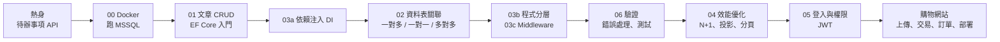

# BlogApi：從零做一個部落格 Web API

一邊做部落格 Web API，一邊學 .NET 後端的學習專案。
筆記分成兩區：**專案主線**是要動手做的課，從小專案做到大專案（熱身的待辦事項 API → 部落格 → 購物網站）；**觀念庫**是 C# 語法、HTTP、EF Core、工具這些觀念頁，做到看不懂的地方再從主線連過去讀。

📖 **學習筆記（HTML 版）**：https://jackson204.github.io/BlogApi/
> 筆記放在 [`docs/`](docs/)，透過 GitHub Pages 發布。每一課都有圖解和練習題，參考答案預設摺疊，寫完再打開對照。

## 全景：發一篇文章，會經過哪些地方？

> 做一個部落格平台的後端 API。明天主管打開網站發一篇文章，後天再打開，**那篇文章必須還在**。

「後天還要在」這句話，會把你從前端一路帶到資料庫：



| 步驟 | 發生什麼 | 在哪一課學 |
|---|---|---|
| ① | 前端送出 HTTP Request：`POST /api/posts`，內容是文章的 JSON | 01 |
| ② | `PostsController` 把 JSON 轉成 `PostRequest` 物件，交給 EF Core | 01；DbContext 怎麼傳進 Controller 是 03 DI |
| ③ | EF Core 把「新增這個物件」翻成 `INSERT` SQL，透過 `Microsoft.Data.SqlClient` 送到資料庫 | 01；連線字串在 00 |
| ④ | SQL Server 執行並寫入磁碟，回傳新文章的編號 | 00 Docker、volume；01 Migration 建表 |
| ⑤ | 後端回傳 `201 Created` + 文章 JSON | 01 |

後天主管再打開網站，前端送出 `GET /api/posts`，走的是同一條路：EF Core 送出 `SELECT`，SQL Server 把存著的文章拿回來，再包成 Response 回給前端。

**要記住的一件事：** 不管中間疊了幾層（Controller、EF Core、SqlClient），最後跟資料庫溝通的永遠是 **SQL**。所以每一課都會「觀察 EF Core 產生的 SQL」。

## 技術

- .NET 10 / ASP.NET Core Web API
- Entity Framework Core
- SQL Server 2022（Docker）

## 學習路線



課程代號（01、02a、06…）是固定的名字，其他課會用它互相指；做的順序以下表和[課程目錄](https://jackson204.github.io/BlogApi/)為準。

### 專案主線

| 專案 | 課程 | 主題 | 狀態 |
|---|---|---|---|
| 熱身 | [待辦事項 API：第一支 Web API](https://jackson204.github.io/BlogApi/lessons/w1-todo-api.html) | 不接資料庫。用指令建立方案與專案、最小的 `Program.cs`、Controller、路由、Model Binding、狀態碼 | ✅ |
| 部落格 | [00 環境準備：用 Docker 跑 MSSQL](https://jackson204.github.io/BlogApi/lessons/00-docker-mssql.html) | Docker、image / container、port、volume、連線字串 | ✅ |
| 部落格 | [01 文章 CRUD：EF Core 入門](https://jackson204.github.io/BlogApi/lessons/01-efcore-crud.html) | DbContext、Migration、LINQ ↔ SQL、User Secrets | ✅ |
| 部落格 | [03a 依賴注入（DI）：從 new 到 DI 容器](https://jackson204.github.io/BlogApi/lessons/03a-di-how-it-works.html) | 沒有 DI 會怎樣、DI 容器怎麼運作、框架怎麼把 DbContext 送進 Controller | ✅ |
| 部落格 | [02a 作者與文章：一對多](https://jackson204.github.io/BlogApi/lessons/02a-one-to-many.html) | 外鍵、導覽屬性、`Include` vs 投影、Response DTO、Cascade / Restrict | ✅ |
| 部落格 | 02b 使用者與個人檔案：一對一 | `HasOne` / `WithOne` | ⏳ |
| 部落格 | 02c 文章與標籤：多對多 | 中介表 | ⏳ |
| 部落格 | 03b 程式分層與自己的 Service | 把邏輯抽出 Controller、生命週期怎麼選、要不要 Repository | ⏳ |
| 部落格 | 03c Middleware：請求管線 | 請求一層一層經過的關卡、順序、短路、在 middleware 裡用 Scoped 服務 | ⏳ |
| 部落格 | 06 驗證、錯誤處理、測試 | FluentValidation、ProblemDetails、單元與整合測試 | ⏳ |
| 部落格 | 04 文章列表效能優化 | N+1、延遲載入、`Select` 投影、`SelectMany`、`AsNoTracking`、分頁 | ⏳ |
| 部落格 | 05 登入與權限 | 註冊、密碼雜湊、JWT、`[Authorize]`、只能改自己的文章 | ⏳ |
| 購物 | 購物 01 商品與分類 | 小商店 schema、商品圖片上傳（`IFormFile`） | ⏳ |
| 購物 | 購物 02 下單：交易與並行 | Transaction、`RowVersion`、扣庫存、搶最後一件 | ⏳ |
| 購物 | 購物 03 購物車與訂單狀態 | 把會員、權限、驗證、佇列、推播串起來 | ⏳ |
| 購物 | 購物 04 部署 | API 包進 Docker、和 MSSQL 一起跑、正式環境設定 | ⏳ |

### 觀念庫

不用動專案的觀念頁，沒有閱讀順序，從主線連過去時再讀。完整清單和搜尋在[課程目錄](https://jackson204.github.io/BlogApi/#concepts)。

| 主題 | 內容 |
|---|---|
| C# 語法 | 類別與物件、方法簽章與委派、async / await、JSON、Dictionary、enum、可空型別 |
| HTTP 與 Web | 網址與 query string、編碼器與 XSS、Cookie、HTTP 快取 |
| EF Core 與資料庫 | [LINQ ↔ SQL 實驗室](https://jackson204.github.io/BlogApi/lessons/01b-linq-sql-lab.html)：獨立 Console 專案 + 小商店資料庫，單表、JOIN、GROUP BY、N+1 等實驗 |
| 工具與整合 | NLog、Typed Client、RabbitMQ、SignalR |

## 專案結構

```
BlogApi/
├─ README.md
├─ BlogApi.sln
├─ BlogApi/          ← Web API 專案（第 1 課建立）
├─ LinqLab/          ← LINQ ↔ SQL 實驗室，Console 專案（01b 建立）
├─ BlogApi.Worker/   ← 收 RabbitMQ 訊息的 Worker Service（補充：RabbitMQ 建立）
├─ BlogApi.SignalRClient/ ← SignalR 的 C# Console 客戶端（補充：SignalR 建立）
└─ docs/             ← 學習筆記（GitHub Pages）
    ├─ index.html    ← 課程目錄：專案主線 + 觀念庫，可搜尋
    ├─ assets/
    └─ lessons/
```

## 本機執行

需要：[.NET 10 SDK](https://dotnet.microsoft.com/download)、[Docker Desktop](https://www.docker.com/products/docker-desktop/)

1. 啟動 SQL Server（詳細說明見第 0 課）

   ```powershell
   docker run -d --name blog-mssql `
     -e "ACCEPT_EULA=Y" `
     -e "MSSQL_SA_PASSWORD=<你的密碼>" `
     -p 1433:1433 `
     mcr.microsoft.com/mssql/server:2022-latest
   ```

2. 執行 API（第 1 課完成後補上）
